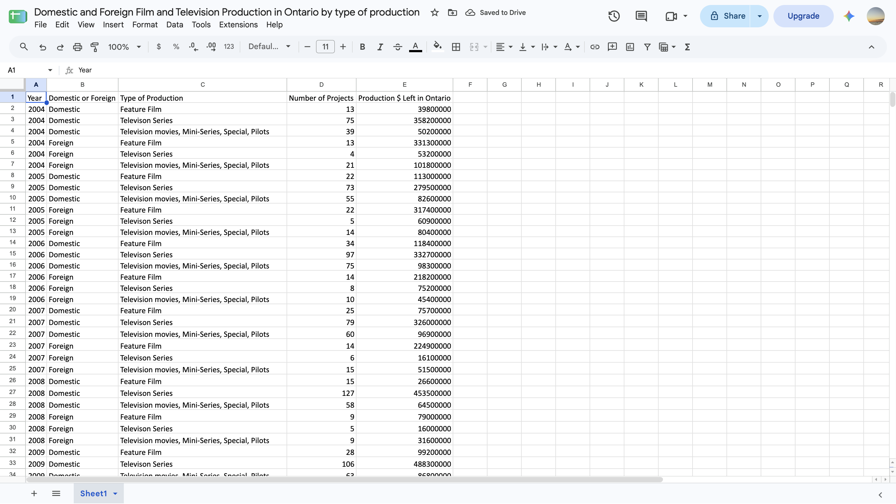
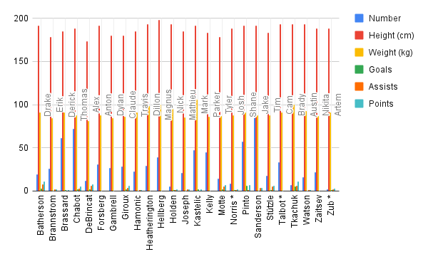

**November 5th,2026** 
**MPAD2003A Introductory Data Storytelling** 
**Amr Saad** 
**Presented to Jean-Sébastien Marier** 

# Deliverable 2: Exploratory Data Analysis (EDA)

Use one hashtag symbol (`#`) to create a level 1 heading like this one.

## Foreword

For this assignment, you must clean and analyze the dataset from Deliverable 1, create exploratory charts/visualizations, and identify a potential story. Your assignment must clearly detail your process. You are expected to write about 1,000-1,200 words, and to include several screen captures showing the different steps you went through. Your assignment must be written with the Markdown format and submitted on GitHub.

I have been assigning different versions of this project to my digital journalism and data storytelling students for a few years now. Its structure was inspired by the main sections/chapters of [*The Data Journalism Handbook*](https://datajournalism.com/read/handbook/one/). This version was further inspired by the [Key Capabilities in Data Science](https://extendedlearning.ubc.ca/programs/key-capabilities-data-science) program offered by the University of British Columbia (UBC).

**Here are some useful resources for this assignment:**

* [GitHub's *Basic writing and formatting syntax* page](https://docs.github.com/en/get-started/writing-on-github/getting-started-with-writing-and-formatting-on-github/basic-writing-and-formatting-syntax)
* [The template repository for this assignment in case you delete something by mistake](https://github.com/jsmarier/jou4100_jou4500_mpad2003_project2_template)

Did you notice how to create a hyperlink? In Markdown, we put the clickable text between square brackets and the actual URL between parentheses.

And to create an unordered list, we simply put a star (`*`) before each item.

## 1. Getting Data

### 1.1. Context
I will be analyzing a dataset that provides information about the amount of film and TV productions in Ontario from 2004 to 2024. This information includes the type of production, the year it was produced, if it is domestic or foreign, and the amount of money spent on each type.

* [Link for my original dataset](https://www.ontariocreates.ca/uploads/About-Us/Eng/open-dataontario-film-and-tv-production-by-type-or-production-Dec-2025.xlsx)

I downloaded the dataset as a xlsx file on my device, then imported it on Google Sheets by pressing file, import, upload, then locating the file on my device, and lastly pressing import data into a new spreadsheet.

 
*Figure 1: My datasheet after importation.*

* [The public link to my Google Sheets spreadsheet](https://docs.google.com/spreadsheets/d/1Tb3NKxemoU-d1DJCOfOgenYs0zpPFrB6O0Iu2H_HTGw/edit?usp=sharing)

### 1.2. General Observations

There are 5 columns and 126 rows

The data looks clean excluding one column. For the “Production $ Left in Ontario” column, it would be easier if the values were formatted in a better way. For example, adding commas between numbers so users can differentiate if this is a value in the thousands, millions, or even higher.

### 1.3. Specific Observations

Column A - Year: Discrete quantitative variables representing year in which film and tv productions were made. The years are whole numbers such as 2004 and 2024.

Column B - Domestic or Foreign: Nominal qualitative variables showing if production is domestic or foreign. These variables are categorical because they divide productions into two different groups without a numerical ranking.

Column C - Type of production: Nominal qualitative variables representing different categories of film and tv productions. These categories include feature films, tv series, and tv movies, mini-series, and specials, and pilots. There is no ranking in these categories.

Column D - Number of projects: Discrete quantitative variables representing number of film and tv projects produced in each category in a specific year. They are discrete because project numbers are whole numbers rather than fractions or decimals.

Column E - Production $ left in Ontario: Continuous quantitative variables representing the amount of money spent in Ontario on film and tv productions measured in Canadian dollars. They are continuous because monetary amounts can include decimal values even though it is not included in this spreadsheet.

### 1.4. One Question from raw data

Is there more money spent on foreign or domestic productions throughout the last 10 years? 

I picked that timeframe specifically because it was around the same time Netflix was introduced to people, so how did that affect the film and tv industry in Ontario?

## 2. Understanding Data

### 2.1. VIMO Analysis

Use three hashtag symbols (`###`) to create a level 3 heading like this one. Please follow this template when it comes to level 1 and level 2 headings. However, you can use level 3 headings as you see fit.

Insert text here.

Support your claims by citing relevant sources. Please follow [APA guidelines for in-text citations](https://apastyle.apa.org/style-grammar-guidelines/citations).

**For example:**

As seen in Bounegru & Gray (2011), a data visualization should be clear...

### 2.2. Cleaning Data

Insert text here.

### 2.3. Analyzing Data

Insert text here.

**This section should include a screen capture of your pivot table, like so:**

 
*Figure 2: This pivot table shows...*

**This section should also include a screen capture of your exploratory chart, like so:**

 
*Figure 3: This exploratory chart shows...*

## 3. Delivering Data

Insert text here.

## 4. References

Include a list of your references here. Please follow [APA](https://apastyle.apa.org/style-grammar-guidelines/references) or [MLA](https://www.mla.org/MLA-Style) guidelines for references. Hanging paragraphs aren't required though.

**Here's an example:**

Bounegru, L., & Gray, J. (Eds.). (2021). *The Data Journalism Handbook 2: Towards A Critical Data Practice*. Amsterdam University Press. [https://ocul-crl.primo.exlibrisgroup.com/permalink/01OCUL_CRL/hgdufh/alma991022890087305153](https://ocul-crl.primo.exlibrisgroup.com/permalink/01OCUL_CRL/hgdufh/alma991022890087305153)
