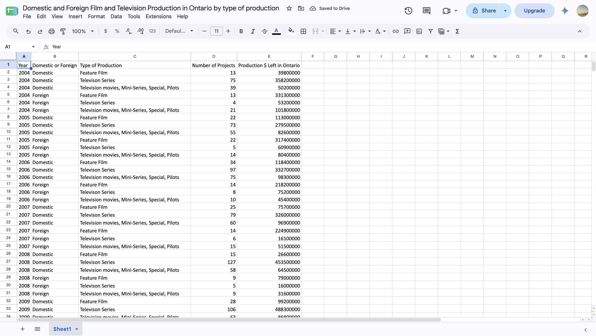
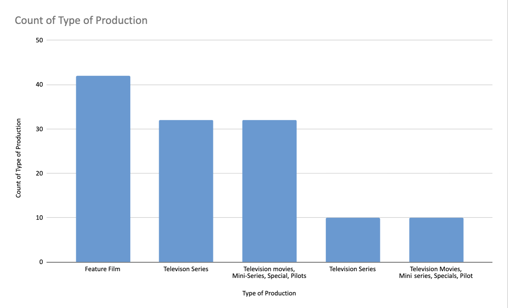
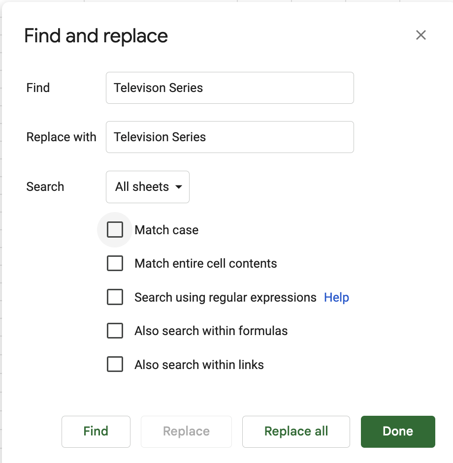
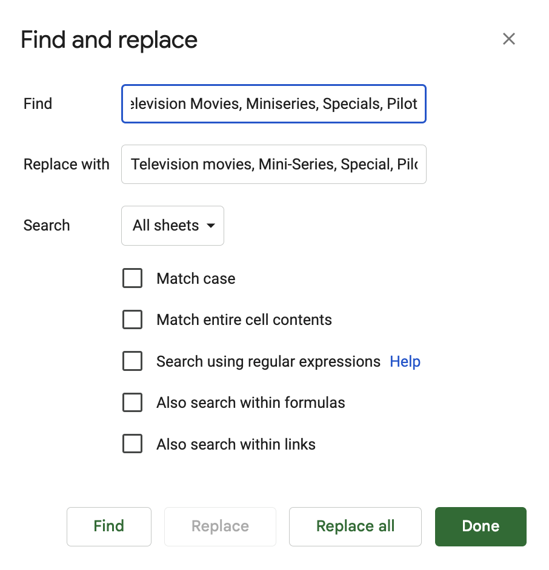
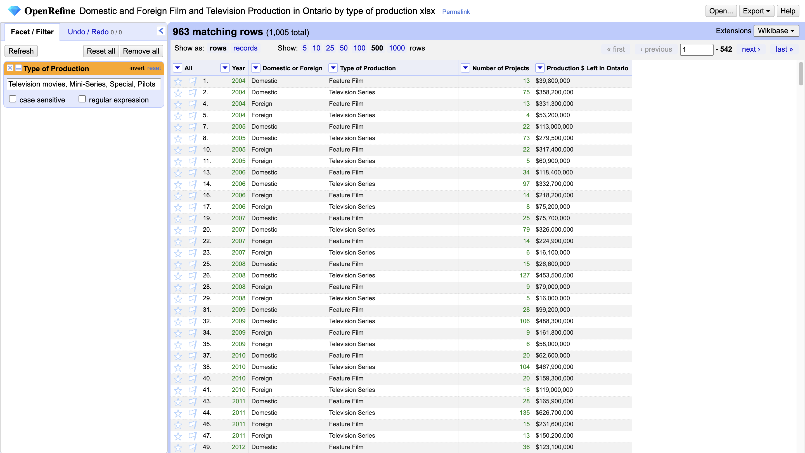
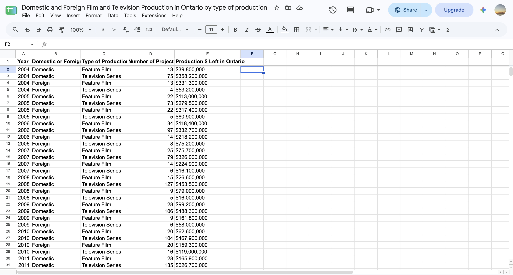
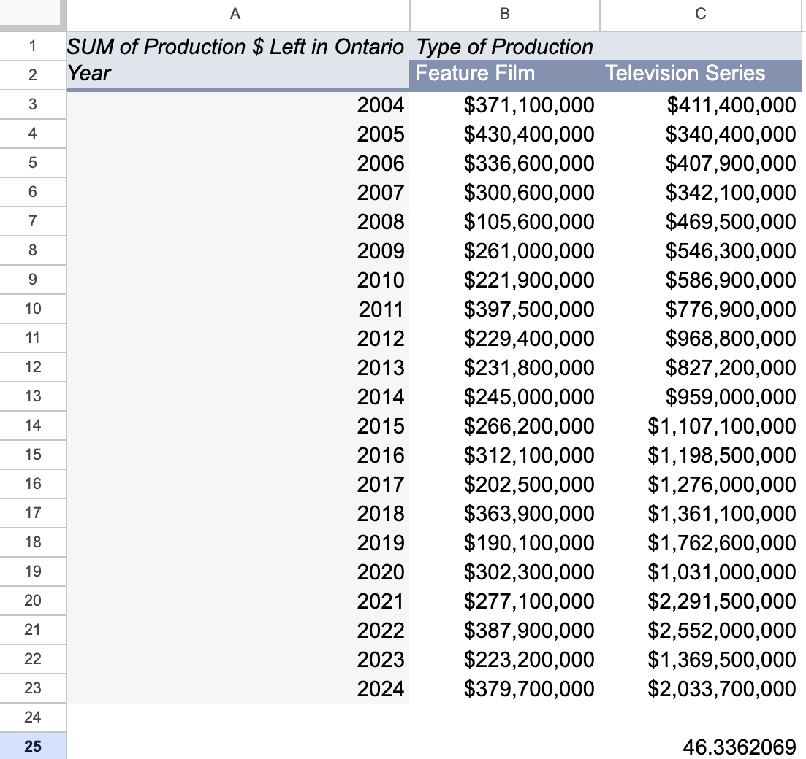
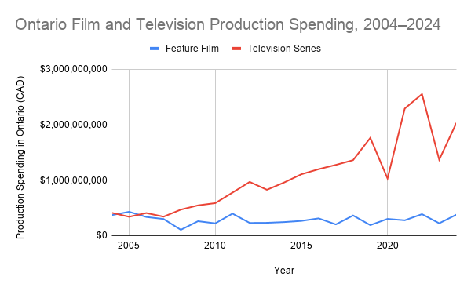

**November 5th,2026** 
**MPAD2003A Introductory Data Storytelling** 
**Amr Saad** 
**Presented to Jean-Sébastien Marier** 

# Deliverable 2: Exploratory Data Analysis (EDA)

Use one hashtag symbol (`#`) to create a level 1 heading like this one.

## Foreword

For this assignment, you must clean and analyze the dataset from Deliverable 1, create exploratory charts/visualizations, and identify a potential story. Your assignment must clearly detail your process. You are expected to write about 1,000-1,200 words, and to include several screen captures showing the different steps you went through. Your assignment must be written with the Markdown format and submitted on GitHub.

I have been assigning different versions of this project to my digital journalism and data storytelling students for a few years now. Its structure was inspired by the main sections/chapters of [*The Data Journalism Handbook*](https://datajournalism.com/read/handbook/one/). This version was further inspired by the [Key Capabilities in Data Science](https://extendedlearning.ubc.ca/programs/key-capabilities-data-science) program offered by the University of British Columbia (UBC).

**Here are some useful resources for this assignment:**

* [GitHub's *Basic writing and formatting syntax* page](https://docs.github.com/en/get-started/writing-on-github/getting-started-with-writing-and-formatting-on-github/basic-writing-and-formatting-syntax)
* [The template repository for this assignment in case you delete something by mistake](https://github.com/jsmarier/jou4100_jou4500_mpad2003_project2_template)

Did you notice how to create a hyperlink? In Markdown, we put the clickable text between square brackets and the actual URL between parentheses.

And to create an unordered list, we simply put a star (`*`) before each item.

## 1. Getting Data

### 1.1. Context
I will be analyzing a dataset that provides information about the amount of film and TV productions in Ontario from 2004 to 2024. This information includes the type of production, the year it was produced, if it is domestic or foreign, and the amount of money spent on each type.

* [Link for my original dataset](https://www.ontariocreates.ca/uploads/About-Us/Eng/open-dataontario-film-and-tv-production-by-type-or-production-Dec-2025.xlsx)

I downloaded the dataset as a xlsx file on my device, then imported it on Google Sheets by pressing file, import, upload, then locating the file on my device, and lastly pressing import data into a new spreadsheet.

  
*Figure 1: My datasheet after importation.*

* [The public link to my Google Sheets spreadsheet](https://docs.google.com/spreadsheets/d/1Tb3NKxemoU-d1DJCOfOgenYs0zpPFrB6O0Iu2H_HTGw/edit?usp=sharing)

### 1.2. General Observations

There are 5 columns and 126 rows

The data looks clean excluding one column. For the “Production $ Left in Ontario” column, it would be easier if the values were formatted in a better way. For example, adding commas between numbers so users can differentiate if this is a value in the thousands, millions, or even higher.

### 1.3. Specific Observations

Column A - Year: Discrete quantitative variables representing year in which film and tv productions were made. The years are whole numbers such as 2004 and 2024.

Column B - Domestic or Foreign: Nominal qualitative variables showing if production is domestic or foreign. These variables are categorical because they divide productions into two different groups without a numerical ranking.

Column C - Type of production: Nominal qualitative variables representing different categories of film and tv productions. These categories include feature films, tv series, and tv movies, mini-series, and specials, and pilots. There is no ranking in these categories.

Column D - Number of projects: Discrete quantitative variables representing number of film and tv projects produced in each category in a specific year. They are discrete because project numbers are whole numbers rather than fractions or decimals.

Column E - Production $ left in Ontario: Continuous quantitative variables representing the amount of money spent in Ontario on film and tv productions measured in Canadian dollars. They are continuous because monetary amounts can include decimal values even though it is not included in this spreadsheet.

### 1.4. One Question from raw data

Is there more money spent on foreign or domestic productions throughout the last 10 years? 

I picked that timeframe specifically because it was around the same time Netflix was introduced to people, so how did that affect the film and tv industry in Ontario?

## 2. Understanding Data

### 2.1. VIMO Analysis

I did a bar chart with the data I have to detect invalid values, and that made me notice that some values in column c are misspelled which results in them getting duplicated in the chart.

  

*Figure 2: Bar chart of dataset.*

### 2.2. Cleaning Data

I used the find and replace tool to correct the misspelled values. 

Television Series was spelled as “Televison”, so I corrected that.

  

*Figure 3: Screen capture of Find & Replace method used.*

"Mini-series" had a hyphen while some values did not, so I corrected that too.

  
*Figure 4: Screen capture of Find & Replace method used.*

I then exported my sheet and uploaded it into OpenRefine. I changed the row number from 50 to 500 so my entire dataset appears. I then pressed on the “Type of Production” column and selected “Text Filter” from the dropdown menu. I copy pasted the “Television movies, Mini-Series, Special, Pilots” value in the text input and then pressed “invert”. I decided to remove all rows with this value because I thought they were unnecessary for the rest of this project. Then, I exported my dataset from “OpenRefine” as an .xls file and reuploaded it into my Google Sheets file. When uploading, I added it into a new sheet named “After OpenRefine Edits” so it is clear that this is the latest version of my dataset.

  
*Figure 5: Screen capture of OpenRefine edits.*

Then I froze the first row and bolded the values so it is clear that all text in these cells were my headings for each column.

  
*Figure 6: Screen capture of dataset after all cleaning processes.*

### 2.3. Analyzing Data

I created a pivot table using my dataset. My row was the “year” values and my columns were the “type of production values”. For my values, I used the “Production $ left in Ontario values”.

Furthermore, I used this pivot table to create a line chart to present my data in a more sophisticated way.

I used these variables specifically because I wanted to see the difference of increase in money spent on both types of production during this 20 year period between 2004 and 2024.

  
*Figure 2: This pivot table shows the amount of money spent on each type of production each year*

  
*Figure 3: This exploratory chart shows difference in money spent on Feature Films vs. Television Series from 2004 to 2024*

One statistic that stands out is that the Television Series sector massively recovered in 2021 (2,291,500,000 CAD dollars) after the drop in 2020 (1,031,000,000 CAD dollars) which was due to the pandemic.

The potential story here is that the “Television Series” sector has been getting bigger each year since 2004 while the “Feature Film’ sector has been largely stagnant. 

In 2007, the numbers for each sector were quite close. Feature Films had 300,600,000 CAD dollars spent on its productions while Television Series had 342,100,000 CAD dollars spent. 

The changing point came the following year in 2008. Feature Films’ numbers decreased to 105,600,000 CAD dollars while Television Series numbers rose to 469,500,000 CAD dollars. From that point onwards, Television Series completely dominated the industry in Ontario and have continued to rise each year reaching 2,033,700,000 CAD dollars in 2024.

A value that would warrant further investigation would be the decrease in production money spent on Television Series from 2022 to 2023. From 2004 to the pandemic, the numbers increased every year and after the recovery in 2021, 2022 was the highest value recorded since 2004. The following year, there was a 46% decrease in production money spent from 2,552,000,000 CAD dollars in 2022 to 1,369,500,000 CAD dollars in 2023. The numbers recovered again in 2024 with a 2,033,700,000 CAD dollars total. The question here would be “what happened in 2023 that caused this large drop?”

I calculated that 46% decrease using the percentage decrease formula which is (Original Value - New Value) / New Value * 100 and I applied that formula to the appropriate cells needed in my pivot table which resulted in = (C21 - C22) / C21 * 100.

## 3. Delivering Data

I would need to research some factors regarding the growth of the Television series sector in Ontario. 

One of these factors would be the introduction of streaming platforms such Netflix, which launched in Canada in 2010. These platforms may have increased the demand for television series production which could be one of the main reasons for the industry’s growth. Another factor would be the writers’ strike in 2023, which could be an important reason for the decline that year.

Another factor I would like to investigate is the impact of government tax incentives. Ontario offers financial incentives to eligible production companies that film in the province. These incentives can help reduce production costs and encourage both domestic and foreign companies to choose Ontario as their filming location.

I could interview a television producer who can further explain the effects streaming platforms had on the industry. Another person I can interview would be a representative from Ontario Creates who can provide more information about the statistics provided on the website and explain industry trends.

## 4. References

Include a list of your references here. Please follow [APA](https://apastyle.apa.org/style-grammar-guidelines/references) or [MLA](https://www.mla.org/MLA-Style) guidelines for references. Hanging paragraphs aren't required though.

**Here's an example:**

Bounegru, L., & Gray, J. (Eds.). (2021). *The Data Journalism Handbook 2: Towards A Critical Data Practice*. Amsterdam University Press. [https://ocul-crl.primo.exlibrisgroup.com/permalink/01OCUL_CRL/hgdufh/alma991022890087305153](https://ocul-crl.primo.exlibrisgroup.com/permalink/01OCUL_CRL/hgdufh/alma991022890087305153)
