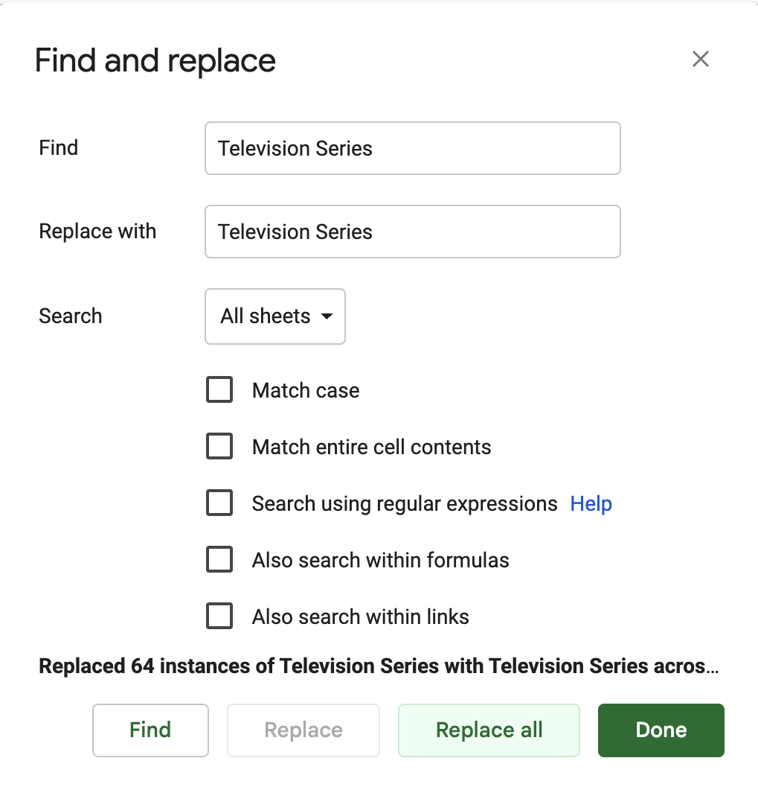

**November 5th, 2026** 
**MPAD2003A Introductory Data Storytelling** 
**Amr Saad** 
**Presented to Jean-Sébastien Marier** 

# Deliverable 2: Exploratory Data Analysis (EDA)

## 1. Getting Data

### 1.1. Context
I will be analyzing a dataset that provides information about the amount of film and TV productions in Ontario from 2004 to 2024. This information includes the type of production, the year it was produced, if it is domestic or foreign, and the amount of money spent on each type of production.

* [Link for my original dataset](https://www.ontariocreates.ca/uploads/About-Us/Eng/open-dataontario-film-and-tv-production-by-type-or-production-Dec-2025.xlsx)

I downloaded the dataset as a xlsx file on my device, then imported it on Google Sheets by pressing *file* -> *import* -> *upload*, then locating the file on my device, and lastly pressing *import data* into a new spreadsheet.

  
*Figure 1: My datasheet after importation.*

* [The public link to my Google Sheets spreadsheet](https://docs.google.com/spreadsheets/d/1Tb3NKxemoU-d1DJCOfOgenYs0zpPFrB6O0Iu2H_HTGw/edit?usp=sharing)

### 1.2. General Observations

There are 5 columns and 126 rows

The data looks clean excluding one column. For the *Production $ Left in Ontario* column, it would be easier if the values were formatted in a better way. For example, adding commas between numbers so users can differentiate if this is a value in the thousands, millions, or even higher.

### 1.3. Specific Observations

Column A - Year: Discrete quantitative variables representing year in which film and tv productions were made. The years are whole numbers such as 2004 and 2024.

Column B - Domestic or Foreign: Nominal qualitative variables showing if production is domestic or foreign. These variables are categorical because they divide productions into two different groups without a numerical ranking.

Column C - Type of production: Nominal qualitative variables representing different categories of film and tv productions. These categories include feature films, tv series, and tv movies, mini-series, and specials, and pilots. There is no ranking in these categories.

Column D - Number of projects: Discrete quantitative variables representing number of film and tv projects produced in each category in a specific year. They are discrete because project numbers are whole numbers rather than fractions or decimals.

Column E - Production $ left in Ontario: Continuous quantitative variables representing the amount of money spent in Ontario on film and tv productions measured in Canadian dollars. They are continuous because monetary amounts can include decimal values even though it is not included in this spreadsheet.

### 1.4. One Question from raw data

Is there more money spent on foreign or domestic productions throughout the last 10 years? 

I picked that timeframe specifically because it was around the same time Netflix was introduced to people, so how did that affect the film and tv industry in Ontario?

## 2. Understanding Data

### 2.1. VIMO Analysis

I did a bar chart with the data I have to detect invalid values, and that made me notice that some values in column c are misspelled which results in them getting duplicated in the chart.

  
*Figure 2: Bar chart of dataset.*

### V
The variables are sufficient to identify and compare trends in Feature Films and Television Series from 2004 - 2024.

The dataset includes the important variables, particularly number of projects and production spending.

I think these columns are all useful because they provide sufficient information needed for any comparisons. 

I prefer having the ability to hide unnecessary rows than explore alternative sources for certain data

For example, I hid all rows containing “Television movies, Mini-Series, Special, Pilots” since I thought they were unnecessary for the story I am trying to explore

I wanted to see a direct comparison between the two main types of production which were Feature Films and Television series, which is why I filtered out those rows when cleaning my data with OpenRefine

### I
No invalid values were found.

All years, project numbers, and production spending looked reasonable

The main issues identified were regarding the formatting and spelling inconsistencies rather than incorrect values

The misspelled categories caused Google sheets to interpret “Television Series” as “Televison Series “

This then led to a misleading representation of my data in this bar chart

### M

All five columns contained values

No empty cells were identified

### O
Only 2 values stood out but they wouldn’t be considered outliers 

The production spending total for Television Series in 2020 declined 41% from 2019 which may be associated with the pandemic

The production spending total for Television Series in 2023 also declined 46% which may be associated with the writers’ strike which lasted five months

These decreases seemed reasonable with the circumstances that occurred at the time 

### 2.2. Cleaning Data

I used the find and replace tool to correct the misspelled values. 

*Television Series* was spelled as *Televison Series*, so I corrected that.

  

*Figure 3: Screen capture of Find & Replace method used.*

*Mini-series* had a hyphen while some values did not, so I corrected that too.

  
*Figure 4: Screen capture of Find & Replace method used.*

I then exported my sheet and uploaded it into *OpenRefine*. I changed the row number from 50 to 500 so my entire dataset appears. I then pressed on the *Type of Production* column and selected *Text Filter* from the dropdown menu. I copy pasted the *Television movies, Mini-Series, Special, Pilots* value in the text input and then pressed *invert*. I decided to remove all rows with this value because I thought they were unnecessary for the rest of this project. Then, I exported my dataset from *OpenRefine* as an .xls file and reuploaded it into my Google Sheets file. When uploading, I added it into a new sheet named *After OpenRefine Edits* so it is clear that this is the latest version of my dataset.

  
*Figure 5: Screen capture of OpenRefine edits.*

Then I froze the first row and bolded the values so it is clear that all text in these cells were my headings for each column.

  
*Figure 6: Screen capture of dataset after all cleaning processes.*

I had to also fix the formatting of my numbers after reuploading my updated sheet because the total was not working correctly in my pivot table.

My 2020 values were labelled like this 161.5*10^6 instead of 161500000, so I manually fixed them by searching the full number on a calculator.

While creating my pivot table, I also noticed that there is a *currency rounded* option to display my values under the *Production $ Left in Ontario* column, so I chose that so these values are easier to read.

I noticed that some *Television Series* and *Feature Film* values had an extra white space character in front of them, so I fixed that using the Find and Replace method.

  

*Figure 7: Screen capture of Find & Replace method used.*

  
*Figure 8: Screen capture of Find & Replace method used.*

### 2.3. Analyzing Data

I created a pivot table using my dataset. My row was the *year* values and my columns were the *type of production values*. For my values, I used the *Production $ left in Ontario* values.

Furthermore, I used this pivot table to create a line chart to present my data in a more sophisticated way.

A line chart shows the differences in total money spent on each type of production and it clearly shows how Television series increased a lot more throughout the years than Feature Films

One of the limitations of my data is that these numbers are not adjusted for inflation.

I used these variables specifically because I wanted to see the difference of increase in money spent on both types of production during this 20 year period between 2004 and 2024.

  
*Figure 9: This pivot table shows the amount of money spent on each type of production each year*

  
*Figure 10: This exploratory chart shows difference in money spent on Feature Films vs. Television Series from 2004 to 2024*

One statistic that stands out is that the Television Series sector massively recovered in 2021 (\$2,291,500,000) after the drop in 2020 (\$1,031,000,000) which was due to the pandemic.

The potential story here is that the Television Series sector has been getting bigger each year since 2004 while the Feature Film sector has been largely stagnant. 

In 2007, the numbers for each sector were quite close. Feature Films had \$300,600,000 spent on its productions while Television Series had \$342,100,000 spent. 

The changing point came the following year in 2008. Feature Films’ numbers decreased to \$105,600,000 while Television Series numbers rose to \$469,500,000. From that point onwards, Television Series completely dominated the industry in Ontario and have continued to rise each year reaching \$2,033,700,000 in 2024.

A value that would warrant further investigation would be the decrease in production money spent on Television Series from 2022 to 2023. From 2004 to the pandemic, the numbers increased through the years and after the recovery in 2021, 2022 was the highest value recorded since 2004. The following year, there was a 46% decrease in production money spent from \$2,552,000,000 in 2022 to \$1,369,500,000 in 2023. The numbers recovered again in 2024 with a \$2,033,700,000 total. The question here would be “what happened in 2023 that caused this large drop?”

I calculated that 46% decrease using the percentage decrease formula which is (Original Value - New Value) / Original Value * 100 and I applied that formula to the appropriate cells needed in my pivot table which resulted in = (C21 - C22) / C21 * 100.

## 3. Delivering Data

I would need to research some factors regarding the growth of the Television series sector in Ontario. 

One of these factors would be the introduction of streaming platforms such Netflix, which launched in Canada in 2010 (Erlichman, 2020) . These platforms may have increased the demand for television series production which could be one of the main reasons for the industry’s growth. Between 2017 and 2020, Netflix invested $2.5 billion into productions of films and tv shows in Canada (Cardin, 2021).

Another factor would be the writers’ strike in 2023, which could be an important reason for the decline that yearr (Los Angeles Times Staff, 2023). 

 Furthermore, I would like to investigate is the impact of government tax incentives. Ontario offers financial incentives to eligible production companies that film in the province (Ontario Creates, 2020). These incentives can help reduce production costs and encourage both domestic and foreign companies to choose Ontario as their filming location.

I could interview a television producer who can further explain the effects streaming platforms had on the industry. Another person I can interview would be a representative from Ontario Creates who can provide more information about the statistics provided on the website and explain industry trends.

## 4. References

Cardin, S. (2021). *Submission to the Standing Committee on Canadian Heritage .* https://www.ourcommons.ca/Content/Committee/432/CHPC/Brief/BR11157882/br-external/Netflix-e.pdf 

Erlichman, J. (2020, September 22). *10 Years on: How Netflix in Canada has evolved a decade later.* BNN Bloomberg. https://www.bnnbloomberg.ca/business/technology/2020/09/22/10-years-on-how-netflix-in-canada-has-evolved-a-decade-later/ 

Los Angeles Times Staff. (2023, October 19). *Writers’ strike: What happened, how it ended and its impact on Hollywood.* Los Angeles Times. https://www.latimes.com/entertainment-arts/business/story/2023-05-01/writers-strike-what-to-know-wga-guild-hollywood-productions 

Open data. (2020, May 4). Ontario Creates. https://www.ontariocreates.ca/research/statistics/open-data-1 

Tax credits. (2020, March 9). Ontario Creates. https://www.ontariocreates.ca/our-sectors/film-tv/tax-credits 

